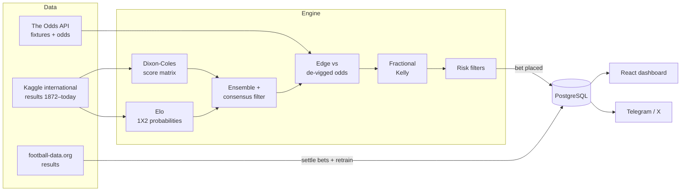

<div align="center">

# ⚽ Club Kelly

**A football match prediction and value-betting engine that paper-trades its own picks.**

Dixon-Coles + Elo ensemble · edge detection against de-vigged bookmaker odds · fractional Kelly staking · layered risk controls

[](https://github.com/flipiflopi/club-kelly/actions/workflows/ci.yml)


[](LICENSE)

[Live site](https://clubkelly.online) · [X / Twitter](https://x.com/ClubKellyBet) · [Telegram](https://t.me/Club_Kelly)

</div>

---

> [!IMPORTANT]
> **Paper trading only.** Club Kelly never places real-money bets. Every stake is simulated against a virtual bankroll so the model's performance can be measured transparently. Nothing in this repository is financial or betting advice.

## Overview

Club Kelly estimates the probability of every outcome of an upcoming match, compares it with the bookmaker market, and — only when it finds a statistically meaningful edge — places a simulated bet sized with the Kelly criterion. Bets are resolved automatically when the match ends, the bankroll is updated, the models are retrained on the new result, and every decision is published to Telegram and X.

The engine was built for the **FIFA World Cup 2026**, but it is competition-agnostic by design: adding La Liga, the Champions League or the Euros is a matter of dropping a YAML file into [`competitions/`](competitions/).

### Highlights

- **Two complementary models.** A time-weighted [Dixon-Coles](https://doi.org/10.1111/1467-9876.00065) Poisson model produces a full score matrix; an importance-weighted Elo model captures opponent strength. Their probabilities are blended, and outcomes where the two models disagree too much are skipped.
- **Pluggable markets.** 1X2, Over/Under 1.5 · 2.5 · 3.5 and Both Teams To Score are derived from the same score matrix. New markets self-register in [`engine/markets/`](engine/markets/).
- **Disciplined decision pipeline.** Bookmaker margin is removed before measuring edge, stakes use quarter Kelly, and five independent risk filters can veto or cap any bet.
- **Closed feedback loop.** Results are synced, bets are settled, Elo is updated incrementally and Dixon-Coles is refit — without manual intervention.
- **Walk-forward backtesting** on past World Cups (2010–2022), reporting accuracy, calibration, Brier score and simulated P&L.
- **Public dashboard** with upcoming picks, bet history and bankroll curve, plus an admin panel for manual settlement and corrections.

## How it works



Each prediction run walks every upcoming match through five layers:

| Layer | Module | What happens |
|---|---|---|
| 1 · Model | [`engine/models/`](engine/models/) | Dixon-Coles (attack/defence strengths, home advantage, low-score correction `ρ`, exponential time decay `ξ`) and Elo produce probabilities. They are blended (50/50 by default); outcomes where the models differ by more than 12 pp are dropped. |
| 1b · Markets | [`engine/markets/`](engine/markets/) | The score matrix is collapsed into probabilities for each registered market. |
| 2 · Edge | [`engine/decision/edge.py`](engine/decision/edge.py) | Bookmaker implied probabilities are normalised to remove the overround. A bet is a candidate only if `model_prob − fair_prob ≥ 3%`. |
| 3 · Sizing | [`engine/decision/kelly.py`](engine/decision/kelly.py) | `f* = (b·p − q) / b`, scaled by a 0.25 multiplier (quarter Kelly). |
| 4 · Risk | [`engine/decision/risk_filters.py`](engine/decision/risk_filters.py) | Rejects odds outside `[1.30, 5.00]`, caps stakes at 3% of bankroll and total open exposure at 15%, limits correlated exposure on the same match, and blocks bets where the model is more than 2× the market consensus (a guard against model error). |

All engine code is pure Python with no I/O or database access, which keeps it fully unit-testable and reusable outside the web app.

## Tech stack

| Area | Technology |
|---|---|
| Modelling | NumPy, SciPy (maximum-likelihood fit with SLSQP), pandas |
| Backend | FastAPI, SQLAlchemy 2, Alembic, Pydantic Settings |
| Database | PostgreSQL 16 |
| Frontend | React 19, TypeScript, Vite, Tailwind CSS, React Router |
| Automation | n8n (cron-driven webhooks) |
| Notifications | Telegram Bot API, X via GetXAPI |
| Tooling | uv, pytest, Ruff, mypy, Docker Compose |

## Project structure

```
.
├── engine/              # Competition-agnostic statistical core (pure functions, no I/O)
│   ├── models/          #   Dixon-Coles and Elo
│   ├── markets/         #   1X2, Over/Under, BTTS — self-registering market modules
│   ├── decision/        #   Edge detection, Kelly sizing, risk filters
│   └── backtest/        #   Walk-forward backtest runner
├── adapters/            # Data sources behind abstract interfaces
│   ├── fixtures/        #   The Odds API, football-data.org, worldcup2026 API
│   ├── odds/            #   The Odds API
│   └── historical/      #   Kaggle international results (training data)
├── backend/app/         # FastAPI application
│   ├── api/v1/          #   REST endpoints, n8n webhooks, admin API
│   ├── models/          #   SQLAlchemy models
│   ├── services/        #   Prediction runner, fixture sync, bet resolver, retrainer, notifiers
│   └── commands/        #   CLI tasks: seed, backtest, notifications, maintenance
├── competitions/        # One YAML config per competition (model, edge, Kelly, risk, data sources)
├── frontend/            # React dashboard (public site + admin panel)
├── migrations/          # Alembic migrations
├── training/            # Offline model training scripts
└── tests/               # pytest suite for the engine and pipeline
```

## Getting started

### Prerequisites

- [Docker](https://docs.docker.com/get-docker/) with Docker Compose
- Python 3.12+ and [uv](https://github.com/astral-sh/uv) (for running tests and scripts locally)
- Node.js 20+ (only if you work on the frontend outside Docker)

### 1. Configure the environment

```bash
cp .env.example .env
```

At minimum set `POSTGRES_PASSWORD` and `SECRET_KEY`. Add `THE_ODDS_API_KEY` to fetch real fixtures and odds — see [Configuration](#configuration).

### 2. Start the stack

```bash
docker compose up --build
```

`docker-compose.override.yml` is picked up automatically in development and enables hot reload:

| Service | Development URL |
|---|---|
| Frontend (Vite) | http://localhost:5173 |
| Backend API | http://localhost:8090 |
| Interactive API docs | http://localhost:8090/docs |
| PostgreSQL | `localhost:5432` |

Database migrations run automatically when the backend container starts.

### 3. Seed the model

Download the [Kaggle international football results](https://www.kaggle.com/datasets/martj42/international-football-results) dataset and save `results.csv` to `training/data/results.csv`. Then:

```bash
docker compose exec backend python -m backend.app.commands.seed --competition worldcup2026
```

This creates the competition, fits Dixon-Coles on the historical data, stores the parameters and opens the paper bankroll.

### 4. Run the pipeline

```bash
curl -X POST http://localhost:8090/v1/webhooks/sync-fixtures
curl -X POST http://localhost:8090/v1/webhooks/run-predictions
```

In production these calls are scheduled by n8n (see [Automation](#automation)).

## Configuration

All settings are read from environment variables (or `.env`).

| Variable | Required | Description |
|---|---|---|
| `POSTGRES_USER` / `POSTGRES_PASSWORD` / `POSTGRES_DB` | Yes | Database credentials |
| `SECRET_KEY` | Yes | Application secret |
| `INITIAL_BANKROLL` | No | Starting paper bankroll in € (default `1000`) |
| `THE_ODDS_API_KEY` | For live data | [The Odds API](https://the-odds-api.com) key — fixtures and odds |
| `FOOTBALL_DATA_API_KEY` | For results | [football-data.org](https://www.football-data.org) key — finished match results |
| `WEBHOOK_API_KEY` | Recommended | Shared secret expected in the `X-API-Key` header of webhook calls (empty disables auth) |
| `ADMIN_API_KEY` | For the admin panel | Key required by `/admin` and `/v1/admin/*` (falls back to `WEBHOOK_API_KEY`; if both are empty the admin API is disabled) |
| `TELEGRAM_BOT_TOKEN` / `TELEGRAM_CHAT_ID` | Optional | Publish picks and results to a Telegram channel |
| `GETXAPI_KEY`, `TWITTER_AUTH_TOKEN`, `TWITTER_CT0`, `TWITTER_TWID` | Optional | Publish to X through [GetXAPI](https://www.getxapi.com) |
| `GITHUB_TOKEN` | Optional | Raises GitHub API rate limits for the worldcup2026 fixture source |
| `ANTHROPIC_API_KEY` | Optional | Reserved for AI-generated bet rationales |

### Adding a competition

Create `competitions/<slug>.yaml` following [`competitions/_schema.yaml`](competitions/_schema.yaml). Each file defines the model hyper-parameters, ensemble weights, edge threshold, Kelly multiplier, risk limits and which data adapters to use. Configurations for La Liga 26/27, the Champions League 26/27 and Euro 2028 are already included.

## Automation

The backend exposes idempotent webhooks designed to be called on a schedule (n8n in production, but any cron works):

| Endpoint | Suggested schedule | Purpose |
|---|---|---|
| `POST /v1/webhooks/sync-fixtures` | Every 60 s during a tournament | Upsert upcoming fixtures and teams |
| `POST /v1/webhooks/run-predictions` | After each fixture sync | Evaluate unpredicted matches and place paper bets |
| `POST /v1/webhooks/sync-results` | Every 5 min | Update scores, settle bets, retrain models |

Pre-match notifications (four hours before kick-off) are sent by a separate command that should run every 30 minutes:

```bash
python -m backend.app.commands.notify_upcoming            # add --dry-run to preview
```

### Other commands

| Command | Description |
|---|---|
| `backend.app.commands.backtest` | Walk-forward backtest on past World Cups (`--wc-years 2014,2018,2022`) |
| `backend.app.commands.check_team_names` | Lists teams in upcoming fixtures that the models do not know |
| `backend.app.commands.reset_bets` | Clears open bets and predictions for upcoming matches so they are re-evaluated |
| `training.train_dixon_coles` | Offline Dixon-Coles fit (`--competition worldcup2026 --min-date 2010-01-01`) |

Run any of them with `uv run python -m <module>` locally or `docker compose exec backend python -m <module>` in Docker.

## API

Interactive OpenAPI documentation is served at `/docs`. The main public endpoints are:

| Endpoint | Description |
|---|---|
| `GET /v1/matches/upcoming` | Upcoming matches with model probabilities and picks |
| `GET /v1/matches/past` | Finished matches with results |
| `GET /v1/bets` · `GET /v1/bets/open` | Paper bet history and open positions |
| `GET /v1/bankroll/snapshot` · `GET /v1/bankroll/history` | Current bankroll, ROI and equity curve |
| `GET /health` | Health check |

## Testing

```bash
uv sync --extra dev
uv run pytest                 # full suite
uv run pytest tests/engine/   # engine only, no database required
uv run ruff check .           # lint
```

The same checks run on every push through [GitHub Actions](.github/workflows/ci.yml).

## Roadmap

- [x] World Cup 2026 — Dixon-Coles + Elo ensemble, 1X2 / O-U / BTTS markets
- [x] Automatic settlement, retraining and Telegram / X publishing
- [ ] Club competitions (La Liga, Champions League) — configs ready, adapters in progress
- [ ] Closing-line value (CLV) tracking on the public dashboard
- [ ] AI-written match previews and bet rationales

## License

Released under the [MIT License](LICENSE).

## Disclaimer

This project is for educational and research purposes. It does not place real bets and does not constitute betting or financial advice. Gambling involves risk — if you choose to bet, do so responsibly and in accordance with the laws of your jurisdiction.
